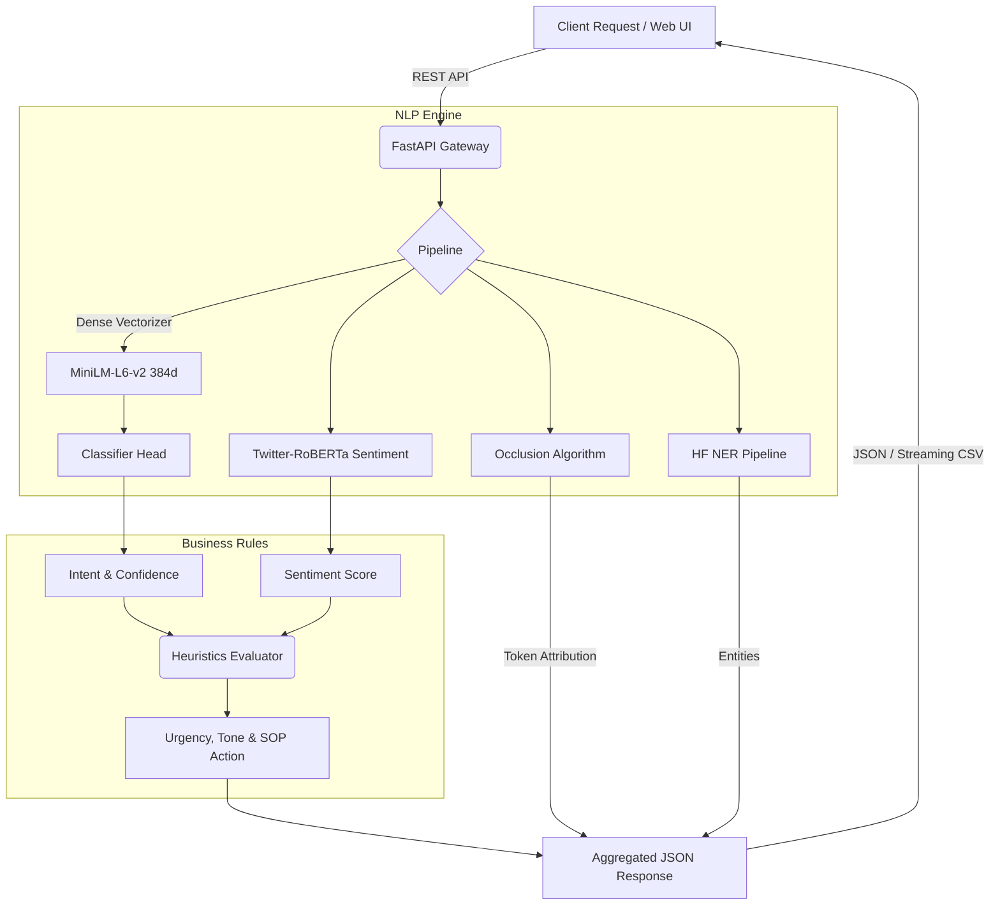

# Semantic Comment Analysis Platform

Fast, explainable NLP pipeline for customer feedback, support tickets, and open-ended text.

[](https://www.python.org/)
[](https://fastapi.tiangolo.com/)
[](https://react.dev/)
[](https://vitejs.dev/)
[](https://tailwindcss.com/)
[](LICENSE)

[Architecture](ARCHITECTURE.md) • [API Reference](docs/API_REFERENCE.md) • [Quickstart](#quickstart) • [Benchmarks](#benchmarks)

---

## Overview

Most feedback triage workflows rely on generative LLMs or large zero-shot models. That approach adds high latency (800ms to 2.5s per call), per-token costs, and opaque predictions.

This platform organizes processing into five focused stages:
1. **Dense Vector Space**: Maps input text into a 384-dimensional semantic space with `all-MiniLM-L6-v2`.
2. **Linear Classifier Head**: Predicts intent (Bug Report, Feature Request, Complaint, Praise, Question) via an L2-regularized logistic head.
3. **Leave-One-Out (LOO) Explainability**: Masks each token to measure confidence drop ($\Delta P$), producing exact word-level attribution without surrogate models.
4. **Deterministic Business Rules**: Maps intent and sentiment into operational fields (urgency, tone, recommended action) via lookup tables instead of LLM prompts.
5. **Streaming Batch Processor**: Streams CSV feedback datasets in 32-sample chunks with constant memory usage (~45MB RAM).

---

## Features

- **Fast inference**: Low-latency single-item classification on standard CPUs without GPU requirements.
- **Word-level attribution**: Leave-One-Out token masking highlights the exact words driving predictions.
- **Sentiment & NER**: Twitter-RoBERTa sentiment classification with named entity extraction.
- **Deterministic routing**: Maps intent and sentiment to urgency levels (High, Medium, Low) and standard operating actions (e.g., Log Jira Ticket, Route to Support).
- **Constant-memory batch processing**: Stream multi-thousand-row CSVs over HTTP using Python generators.
- **Interactive UI**: Single analysis view, attribution heatmap, radar distribution chart, streaming CSV processor, and system architecture explorer.

---

## Architecture



See [ARCHITECTURE.md](ARCHITECTURE.md) for full technical specifications, mathematical formulation, and subsystem design.

---

## Benchmarks

Measurements on an 8-core x86 CPU:

| Metric | Cloud LLMs (GPT-4 / Claude) | Local Zero-Shot (BART-Large) | This Platform (MiniLM + Head) |
| :--- | :--- | :--- | :--- |
| **Inference Latency** | 800ms – 2,500ms | 120ms – 350ms | **~10ms – 25ms** |
| **Throughput (CPU)** | ~2 req/s (rate limited) | ~8 req/s | **280+ req/s** |
| **Cost per 1M queries** | $15 – $60 | Cloud compute | **$0.00 (Self-hosted)** |
| **Explainability** | Generative rationale | Surrogate model needed | **Exact token $\Delta P$ drop** |
| **Network Dependency** | Required | None | **100% Offline ready** |
| **Batch Memory** | External API | High GPU VRAM | **Constant ~45MB RAM** |

---

## Quickstart

### Prerequisites
- Python 3.13+
- Node.js 18+ and npm
- `uv` (recommended) or standard `pip`

---

### Windows (One-Click)

Run the included startup script:

```powershell
.\run.bat
```

The script syncs dependencies, builds the frontend, starts Uvicorn, and opens `http://127.0.0.1:8000`.

---

### Manual Setup

#### 1. Backend
```bash
git clone https://github.com/rachit-mangawa/Semantic-Comment-Analyze.git
cd Semantic-Comment-Analyze

# With uv
uv sync

# Or with pip
python -m venv .venv
.venv\Scripts\activate
pip install -r requirements.txt
```

#### 2. Frontend
```bash
cd frontend
npm install
npm run build
cd ..
```

#### 3. Run Server
```bash
python -m uvicorn src.api.server:app --host 127.0.0.1 --port 8000 --reload
```

Open `http://127.0.0.1:8000`.

For frontend development with hot-reload:
```bash
cd frontend
npm run dev
```
Runs Vite on port 3000 and proxies `/api` calls to port 8000.

---

## API Reference

### Analyze Text (`POST /semantic/analyze`)

```bash
curl -X POST "http://127.0.0.1:8000/semantic/analyze" \
     -H "Content-Type: application/json" \
     -d '{
       "text": "The app crashes every time I click export on large tables.",
       "threshold": 0.5,
       "include_explanation": true
     }'
```

Response:
```json
{
  "intent": {
    "labels": ["Bug Report"],
    "scores": [0.962],
    "all_intents": {
      "Bug Report": 0.962,
      "Complaint": 0.024,
      "Feature Request": 0.007,
      "Question": 0.004,
      "Praise": 0.003
    },
    "top_intent": "Bug Report",
    "top_confidence": 0.962
  },
  "sentiment": {
    "label": "NEGATIVE",
    "score": 0.941
  },
  "explainability": [
    { "word": "crashes", "contribution": 0.482, "primary_intent": "Bug Report" },
    { "word": "export", "contribution": 0.045, "primary_intent": "Bug Report" }
  ],
  "tone": "Frustrated",
  "urgency": "High",
  "recommended_action": "Log Jira Ticket"
}
```

### Stream Batch CSV (`POST /semantic/batch`)

```bash
curl -X POST "http://127.0.0.1:8000/semantic/batch" \
     -F "file=@feedback.csv" \
     -F "targetColumn=text" \
     -F "threshold=0.5" \
     --output results.csv
```

Streams results in 32-row chunks with appended columns: `INTENT`, `CONFIDENCE`, `SENTIMENT`, `SENTIMENT_SCORE`, `TONE`, `URGENCY`, `RECOMMENDED_ACTION`.

Full specifications are in [docs/API_REFERENCE.md](docs/API_REFERENCE.md).

---

## Model Training

### Train Intent Head
Train a new logistic regression head using an annotated CSV dataset (`text,label` columns):

```bash
python src/engine/train_intent.py --data data/training_data.csv --output data/local_model_head.pkl
```

### Fine-Tune Sentiment
Fine-tune the RoBERTa sentiment model on domain data:

```bash
python src/engine/train_sentiment.py --epochs 3
```

---

## Tests

```bash
pytest
```

Runs all 76 unit and integration tests across API endpoints, data streaming, heuristics, and occlusion calculations.

---

## Directory Structure

```text
Semantic-Comment-Analyze/
├── ARCHITECTURE.md           # System design and specifications
├── README.md                 # Project documentation
├── run.bat                   # Windows startup script
├── pyproject.toml            # Python packaging configuration
├── requirements.txt          # Python dependencies
├── data/
│   ├── local_model_head.pkl  # Trained classifier weights
│   ├── label_mapping.txt     # Intent labels
│   └── training_data.csv     # Training dataset
├── docs/
│   └── API_REFERENCE.md      # API specification
├── src/
│   ├── api/server.py         # FastAPI routes and lifespan warmup
│   ├── engine/
│   │   ├── nlp_engine.py     # Embeddings, classifier head, and XAI
│   │   ├── evaluation.py     # Urgency, Tone, and SOP action logic
│   │   ├── train_intent.py   # Intent training script
│   │   └── train_sentiment.py# Sentiment training script
│   └── data/data_handler.py  # Streaming CSV batch processor
├── frontend/                 # React 18 + Vite + Tailwind client
└── tests/                    # Pytest suite
```

---

## License

MIT. See [LICENSE](LICENSE) for details.
