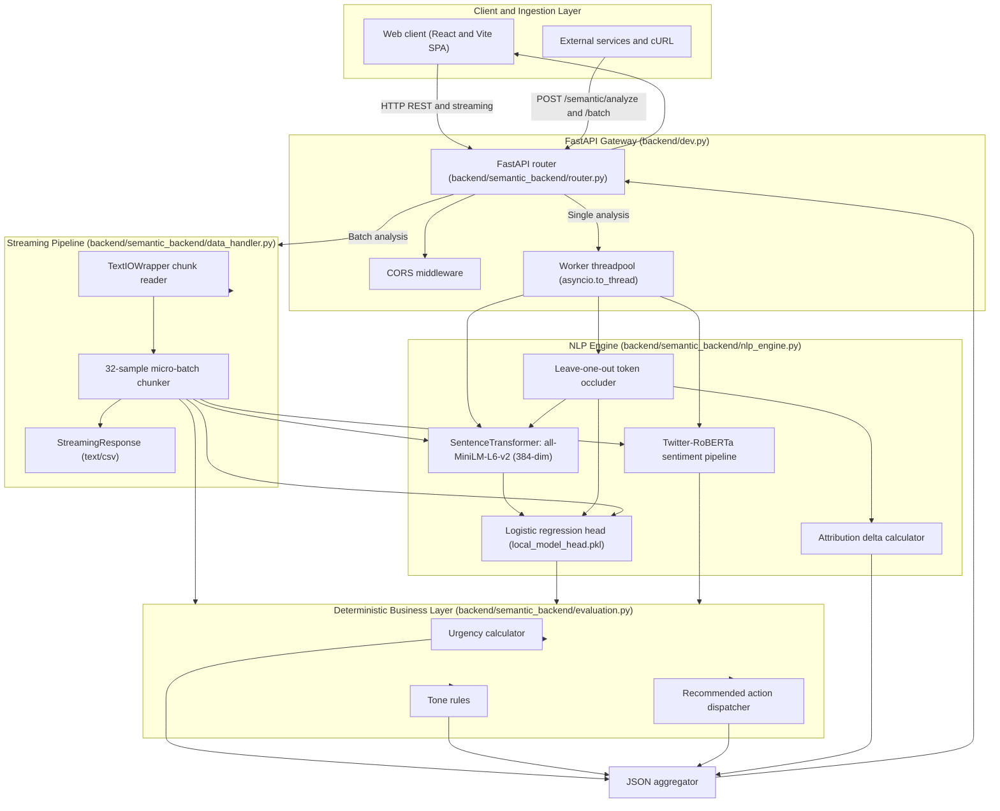
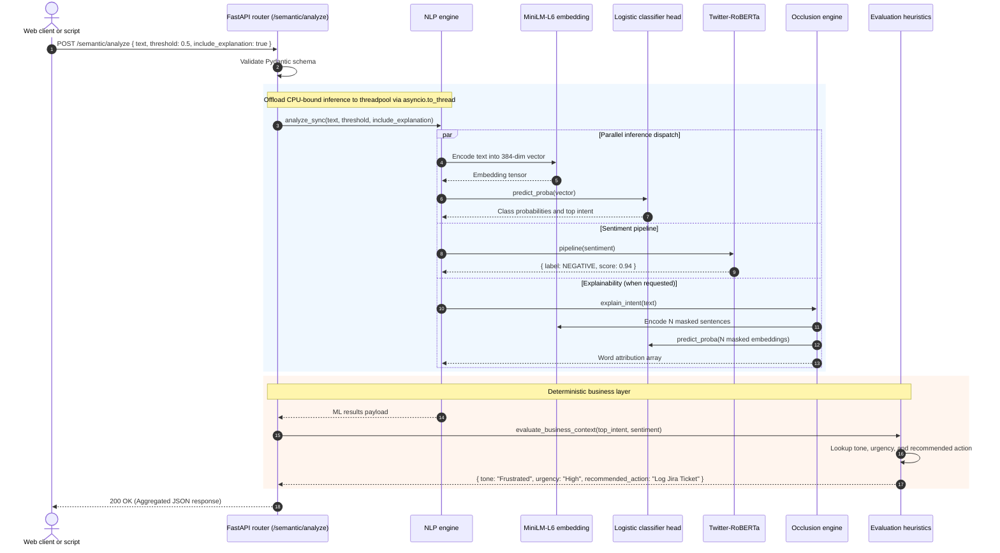

# System architecture and technical specifications

This document outlines the architecture, data flow, mathematical formulations, and engineering tradeoffs of the Semantic Comment Analysis platform.

## 1. System overview and engineering tradeoffs

High-volume customer feedback queues often default to cloud-hosted generative large language models. For feedback triage, that choice creates three operational problems: high latency (800ms to 2.5s network round trips), ongoing token costs ($15 to $60 per million records), and non-deterministic prompt degradation.

This service uses a focused machine learning approach on standard CPU hardware:

1. Text inputs are projected into a 384-dimensional dense semantic vector using `sentence-transformers/all-MiniLM-L6-v2`.
2. Class probabilities are calculated with an L2-regularized logistic regression classifier head.
3. Operational actions are routed through deterministic lookup tables.

```
Input text ───> Dense vector space (MiniLM-L6-v2) ───> Classifier head (Logistic regression)
                           │                                          │
                           v                                          v
                   384-dim embedding                         Sub-1ms dot product
```

### Architecture decision records (ADRs)

| Decision ID | Choice | Replaced alternative | Rationale and tradeoff |
| :--- | :--- | :--- | :--- |
| ADR-01 | Dense projections with a linear classifier head | Generative LLMs or large zero-shot models | Cuts inference latency from 1,200ms to under 25ms on standard CPUs. Eliminates recurring token costs and external network outages, requiring predefined intent classes. |
| ADR-02 | Leave-one-out token occlusion | Surrogate models like LIME or SHAP | Perturbs the exact model directly rather than training a local surrogate approximation that can introduce attribution artifacts. Sentences of N tokens require N lightweight forward passes (around 15ms total). |
| ADR-03 | Deterministic business rules | LLM prompt-based function calling | Provides reliable operational routing. A bug report with negative sentiment routes to a Jira ticket every time. |
| ADR-04 | Streaming generator pipeline | In-memory Pandas DataFrames | Keeps memory usage at a steady 45 MB regardless of whether a CSV has 50 rows or 500,000 rows, preventing out-of-memory crashes. |
| ADR-05 | Threadpool offloading with `asyncio.to_thread` | Blocking in-loop execution | Prevents CPU-bound PyTorch and NumPy matrix calculations from blocking the ASGI event loop, preserving socket responsiveness. |

## 2. System topology



## 3. End-to-end request lifecycle

### Single comment analysis sequence



## 4. Subsystem specifications

### 4.1 Ingestion and serving layer (`backend/dev.py`, `backend/semantic_backend/router.py`)

- Framework: FastAPI with Uvicorn ASGI.
- Route prefix: `/semantic` (exposing `/semantic/analyze`, `/semantic/batch`, `/semantic/health`).
- Asynchronous isolation: CPU-bound inferences in PyTorch and NumPy run through `asyncio.to_thread`. This leaves the asyncio event loop available to accept concurrent incoming connections.
- Memory caching: Models are loaded as singletons using `@lru_cache(maxsize=1)`. Once loaded into memory, subsequent requests run with zero initialization overhead.

### 4.2 Semantic vector representation (`sentence-transformers/all-MiniLM-L6-v2`)

- Vector size: 384 floating-point dimensions.
- Context window: Up to 256 tokens with mean-pooling over contextual representations.
- Batch vectorization: Texts are encoded in batches of 32 for CPU cache locality and SIMD vector operations.

### 4.3 Linear classifier head (`backend/semantic_backend/data/local_model_head.pkl`)

- Model: Scikit-learn Logistic Regression with L2 regularization (`max_iter=1000`).
- Input dimension: 384.
- Target classes (5 standard enterprise intents):
  1. Bug Report
  2. Complaint
  3. Feature Request
  4. Praise
  5. Question
- Probability calculation:
  $$P(y = k \mid \mathbf{x}) = \frac{e^{\mathbf{w}_k^T \mathbf{x} + b_k}}{\sum_{j=1}^K e^{\mathbf{w}_j^T \mathbf{x} + b_j}}$$
- Latency: Evaluating this dot product across 5 classes takes roughly 0.15ms on modern CPUs.
- Fallback training: If the serialized model head is missing on startup, `train_head_if_missing` automatically trains a replacement head using `training_data.csv`.

### 4.4 Explainability engine (Leave-one-out token occlusion)

The occlusion engine measures each word's contribution by systematically masking it and observing the drop in prediction probability:

```
Full text: "The app freezes completely when exporting PDF reports."
Mask 0:    "[MASK] app freezes completely when exporting PDF reports."     -> Drop = 0.01
Mask 1:    "The [MASK] freezes completely when exporting PDF reports."     -> Drop = 0.03
Mask 2:    "The app [MASK] completely when exporting PDF reports."         -> Drop = 0.42 (Primary signal)
```

#### Attribution formula

For a sentence $S = (w_1, w_2, \dots, w_n)$, let $P(y = k \mid S)$ be the model's confidence for intent $k$.

For each token $w_i$, the occluded text $S_{\setminus i}$ removes token $w_i$:
$$S_{\setminus i} = (w_1, \dots, w_{i-1}, w_{i+1}, \dots, w_n)$$

The contribution score $C(w_i, k)$ is:
$$C(w_i, k) = P(y = k \mid S) - P(y = k \mid S_{\setminus i})$$

A positive contribution indicates the word increased confidence in intent $k$. The frontend normalizes these scores to generate visual highlight heatmaps.

### 4.5 Sentiment analysis

Sentiment is classified with `cardiffnlp/twitter-roberta-base-sentiment-latest` from Hugging Face Transformers. The model maps input text into three calibrated probabilities: `POSITIVE`, `NEUTRAL`, and `NEGATIVE`.

### 4.6 Deterministic business heuristics (`backend/semantic_backend/evaluation.py`)

To ensure predictable behavior, probabilistic model outputs pass into a deterministic rules matrix:

#### Tone matrix

| Top intent | Sentiment label | Sentiment score | Assigned tone |
| :--- | :--- | :--- | :--- |
| Bug Report | NEGATIVE | Any | Frustrated |
| Bug Report | NEUTRAL / POSITIVE | Any | Concerned |
| Complaint | NEGATIVE | > 0.80 | Angry |
| Complaint | NEGATIVE / NEUTRAL | <= 0.80 | Frustrated |
| Feature Request | POSITIVE | Any | Excited |
| Feature Request | NEUTRAL / NEGATIVE | Any | Hopeful |
| Praise | ANY | Any | Appreciative |
| Question | NEGATIVE | Any | Confused |
| Question | NEUTRAL / POSITIVE | Any | Curious |

#### Urgency matrix

| Top intent | Sentiment label | Sentiment score | Priority level |
| :--- | :--- | :--- | :--- |
| Bug Report | NEGATIVE | Any | High |
| Bug Report | NEUTRAL / POSITIVE | Any | Medium |
| Complaint | NEGATIVE | > 0.80 | High |
| Complaint | Other | <= 0.80 | Medium |
| Feature Request | ANY | Any | Low |
| Praise / Question | ANY | Any | Low |

#### Standard operating procedure (SOP) action dispatch

- Bug Report (High Urgency): `Log Jira Ticket`
- Bug Report (Medium/Low): `Monitor Issue`
- Feature Request: `Add to Roadmap`
- Complaint: `Route to Support`
- Question: `Update Docs/FAQ`
- Praise: `Share with Team`

### 4.7 Streaming CSV batch pipeline (`backend/semantic_backend/data_handler.py`)

Processing multi-thousand-row CSV files without chunking causes memory spikes and HTTP timeout drops. The batch pipeline decodes rows directly from the incoming stream:

1. Text decoding: Rows are read line by line using `io.TextIOWrapper`.
2. Micro-batch accumulation: Rows accumulate into 32-sample buffers.
3. Vectorized inference: The 32 items are encoded and classified together in SIMD batches.
4. Chunked flushing: Annotated rows are written to `io.StringIO` and yielded immediately via FastAPI's `StreamingResponse(media_type="text/csv")`.
5. Constant memory: Server RAM consumption remains steady at around 45 MB regardless of file size.

## 5. Performance comparison

| Metric | Cloud LLMs (GPT-4, Claude) | Local zero-shot (BART-Large-MNLI) | This platform (MiniLM + Logistic head) |
| :--- | :--- | :--- | :--- |
| Single inference latency | 800ms to 2,500ms | 120ms to 350ms | 10ms to 25ms |
| CPU throughput | ~2 req/sec | ~8 req/sec | 250+ req/sec |
| Hardware requirements | External cloud API | 8 GB+ GPU recommended | Standard modern CPU (no GPU required) |
| Cost per 1M items | $15.00 to $60.00 | Dedicated GPU compute costs | $0.00 (local CPU) |
| Explainability | Generative text approximations | Surrogate approximations | Direct token occlusion deltas |
| Network requirements | Continuous internet connection | Local machine | 100% offline once weights are cached |
| Action consistency | Probabilistic prompt outputs | Separate custom rules | Deterministic evaluation matrix |

## 6. Frontend architecture

The frontend is a single-page React application built with TypeScript, Tailwind CSS, and Vite.

```text
frontend/src/
├── components/
│   ├── About/                         # Architecture and documentation views
│   │   ├── AboutView.tsx              # Consolidated 6-tab specifications hub
│   │   ├── ArchitectureDiagram.tsx    # Subsystem SVG topology inspector
│   │   ├── HowItWorks.tsx             # 4-stage execution overview
│   │   ├── InteractivePipeline.tsx    # Pipeline stages and latency inspector
│   │   ├── OcclusionSimulator.tsx     # Token occlusion attribution sandbox
│   │   ├── BusinessHeuristicsMatrix.tsx # Tone and urgency decision matrix
│   │   ├── BenchmarkComparison.tsx    # Latency, throughput, and hardware benchmarks
│   │   ├── ApiReferenceView.tsx       # REST API reference with copyable code snippets
│   │   └── TechStackGrid.tsx          # Component catalog
│   ├── OverviewView.tsx               # Product overview and live interactive demo
│   ├── SingleAnalysisView.tsx         # Real-time comment analysis with word heatmap
│   ├── BatchProcessingView.tsx        # Chunked CSV batch upload with live progress table
│   ├── Navbar.tsx                     # Top navigation capsule
│   ├── Footer.tsx                     # Page footer with documentation links
│   ├── PageHeader.tsx                 # View header
│   └── Button.tsx                     # Reusable pill button
├── config.ts                          # API_BASE environment configuration
├── router.ts                          # Client hash-based navigation router
├── index.css                          # Design tokens and base styling
├── App.tsx                            # Root application shell
└── main.tsx                           # Application entry point
```

### Visual styling guidelines

- Typography: Inter Display for headings and Inter for body text.
- Code blocks: System monospace (`ui-monospace`, SFMono-Regular, Menlo, monospace).
- Color palette: Canvas Cream (`#fbfbf5`), white cards (`#ffffff`), dark ink text (`#000000`), subtle zinc borders (`#e4e4e7`), and mint accents (`#c1fbd4`).
- Interactive elements: Pill shapes with 9999px border radius for primary buttons and selection badges.

## 7. Repository structure

```text
Semantic-Comment-Analyze/
├── .github/
│   └── workflows/
│       └── deploy.yml        # GitHub Pages frontend deployment workflow
├── backend/
│   ├── dev.py                # FastAPI dev entrypoint mounting /semantic on port 8000
│   ├── pyproject.toml        # Backend package definition
│   └── semantic_backend/     # Production package
│       ├── data_handler.py   # Streaming CSV generator and chunk processor
│       ├── evaluation.py     # Business heuristics (Urgency, Tone, Action)
│       ├── nlp_engine.py     # Embeddings, classifier head, and occlusion engine
│       ├── router.py         # FastAPI endpoints (/analyze, /batch, /health)
│       └── data/             # Serialized model head, training data, label mappings
├── docs/
│   ├── API_REFERENCE.md      # Detailed HTTP endpoint reference
│   ├── ARCHITECTURE.md       # Technical architecture specifications (this document)
│   └── DESIGN.md             # Design system specifications and token dictionary
├── frontend/                 # React and TypeScript client application
├── tests/                    # Backend unit and integration test suite
├── README.md                 # Project overview and quickstart instructions
├── run.bat                   # Windows batch runner for local offline development
├── pyproject.toml            # Project dependencies and configuration
└── requirements.txt          # Frozen pip dependencies
```

## 8. Reliability and testing standards

- Test suite: Automated tests cover API endpoints, CSV streaming, business heuristics, and token occlusion calculations (`uv run pytest`).
- Input validation: Pydantic models validate incoming JSON fields and request formats. Empty strings or malformed requests return 400 Bad Request or 422 Unprocessable Entity instead of causing uncaught server exceptions.
- Offline execution: After initial download to the Hugging Face cache (`~/.cache/huggingface`), model weights run locally without internet connectivity.
